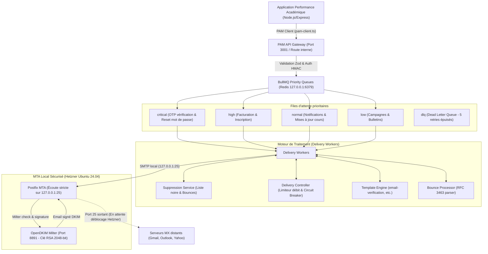

# Performance Academy Mail (PAM)

**Performance Academy Mail (PAM)** est l'infrastructure de messagerie autonome, hautement résiliente et zéro coût additionnel (\$0/mois) conçue pour l'écosystème **Performance Académique**.

Elle opère directement sur le serveur Hetzner (`167.233.62.125`) pour le domaine `perfacademy.ma` et le sous-domaine MTA `mail.perfacademy.ma`.

---

## 1. Architecture du Système



---

## 2. Structure des Répertoires

```
performance-academy-mail/
├── apps/
│   ├── api-gateway/              # API REST sécurisée (Health, Metrics, Send, Bulk, Suppressions)
│   └── delivery-workers/         # Moteur de distribution multi-niveaux et gestion des priorités
├── infrastructure/
│   ├── dns/                      # Scripts de génération et spécifications des enregistrements DNS
│   ├── opendkim/                 # Clés privées/publiques RSA 2048-bit et configuration Milter
│   ├── postfix/                  # main.cf durci (Anti-Relay, TLS, Milters) et setup-postfix.sh
│   └── smtp-mock/                # Serveur SMTP RFC 5321 in-repo pour tests complets hors-réseau
├── packages/
│   ├── security/                 # Hachage constant-time, clés API `pam_live_...`
│   ├── shared-types/             # Interfaces TypeScript partagées (Priorités, Statuts, DSN)
│   └── validation/               # Schémas Zod stricts pour toutes les entrées
├── services/
│   ├── bounce-processor/         # Détection rebonds RFC 3463 (5.1.1, 4.2.2, etc.)
│   ├── delivery-controller/      # Rate limiter par domaine & Circuit Breaker
│   ├── queue-service/            # Gestion BullMQ & fallback mémoire avec déduplication
│   ├── suppression-service/      # Protection réputation par suppression automatique
│   └── template-engine/          # Rendu HTML/texte sécurisé contre injection
├── tests/
│   └── pam-end-to-end.test.ts    # Suite complète de test validant les 20 exigences
└── README.md
```

---

## 3. Configuration et Installation

### Variables d'environnement requises

```env
# Clé secrète maître pour l'API Gateway PAM
PAM_API_KEY=pam_live_xxxxxxxxxxxxxxxxxxxxxxxxxxxxxxxx

# Connexion Redis pour les files BullMQ
PAM_REDIS_URL=redis://127.0.0.1:6379

# Configuration MTA
PAM_MTA_HOST=127.0.0.1
PAM_MTA_PORT=25
PAM_MTA_SECURE=false

# Expéditeur officiel
PAM_DEFAULT_FROM="Performance Académique <verification@perfacademy.ma>"
```

### Installation de Postfix & OpenDKIM sur Hetzner

```bash
sudo bash /var/www/axelmond/performance-academy-mail/infrastructure/postfix/setup-postfix.sh
```

Ce script configure automatiquement :
1. Postfix configuré en mode **Internet Site** restreint strictement à la boucle locale (`inet_interfaces = 127.0.0.1, [::1]`).
2. Protection absolue contre l'Open Relay (`smtpd_relay_restrictions = permit_mynetworks, reject`).
3. OpenDKIM configuré sur le port `127.0.0.1:8891` pour signer automatiquement les messages avec le sélecteur `mail`.

---

## 4. Endpoints de Surveillance et Santé

- **`GET /api/v1/health`** : Vérifie l'état de santé du MTA, de Redis et des files d'attente.
- **`GET /api/v1/metrics`** : Exporte les compteurs de messages traités, livrés, différés, rejetés et la taille des files d'attente.
- **`POST /api/v1/emails/send`** : Envoi unitaire avec support de priorité (`critical`, `high`, `normal`, `low`) et clé d'idempotence (`idempotencyKey`).
- **`POST /api/v1/emails/bulk`** : Envoi groupé par lot avec suivi individuel des identifiants `pam_msg_...`.
- **`GET /api/v1/emails/:id`** : Consultation en temps réel du statut de distribution d'un message.
- **`GET /api/v1/suppressions/:email`** : Vérification de l'état d'un destinataire dans la liste de suppression.

---

## 5. Gestion des Rebondissements et Réputation

| Code SMTP / DSN | Type de Rebond | Action Automatique |
|---|---|---|
| `550 5.1.1` | Hard Bounce (Boîte inexistante) | Inscription immédiate en liste de suppression |
| `554 5.7.1` | Policy Reject (Blocage contenu / SPF) | Inscription en liste de suppression |
| `421 4.7.0` | Soft Bounce (Serveur saturé) | Ré-enfilement avec backoff exponentiel |
| `452 4.2.2` | Soft Bounce (Boîte pleine) | Ré-enfilement (jusqu'à 5 tentatives) |
